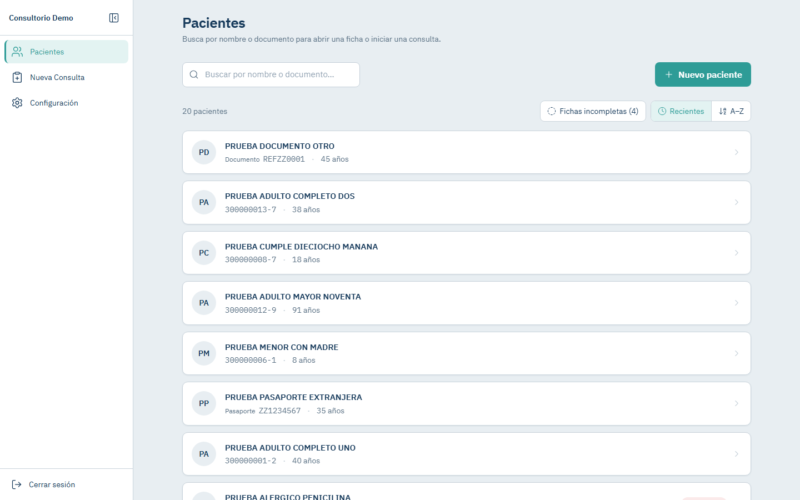
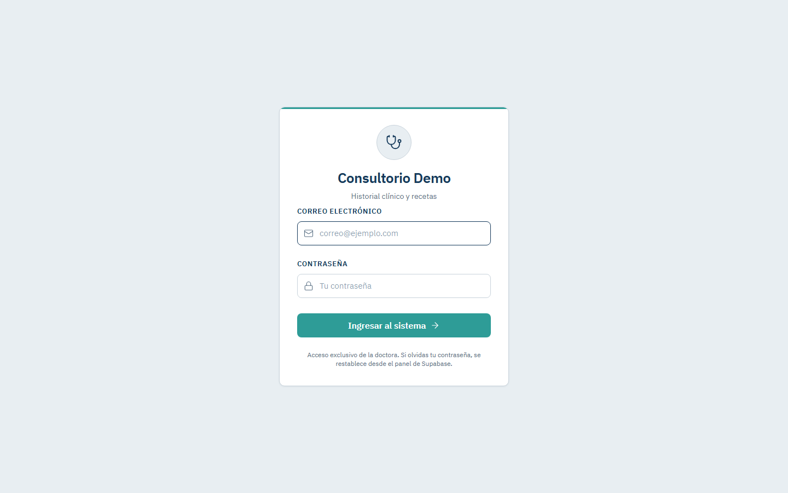
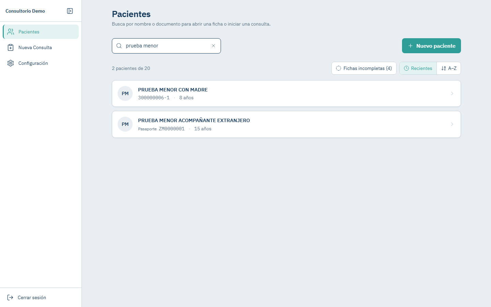
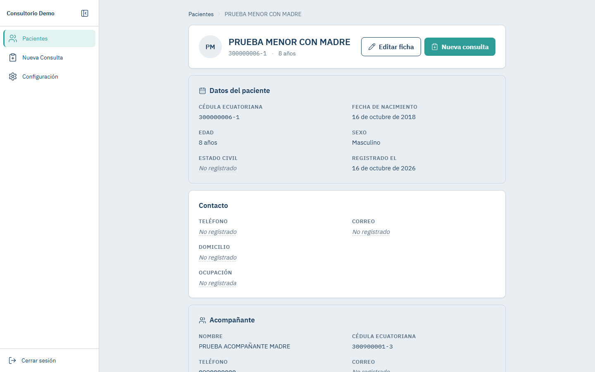
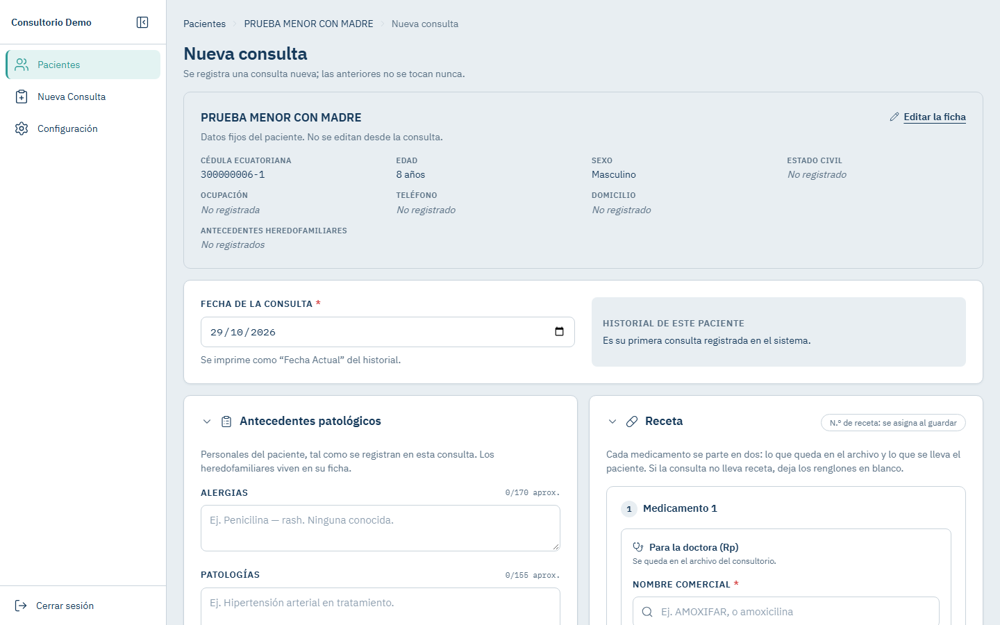
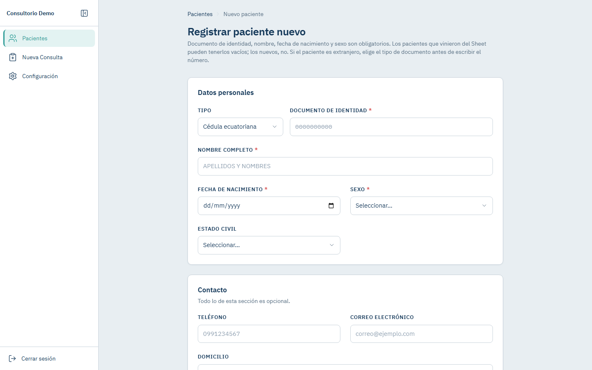
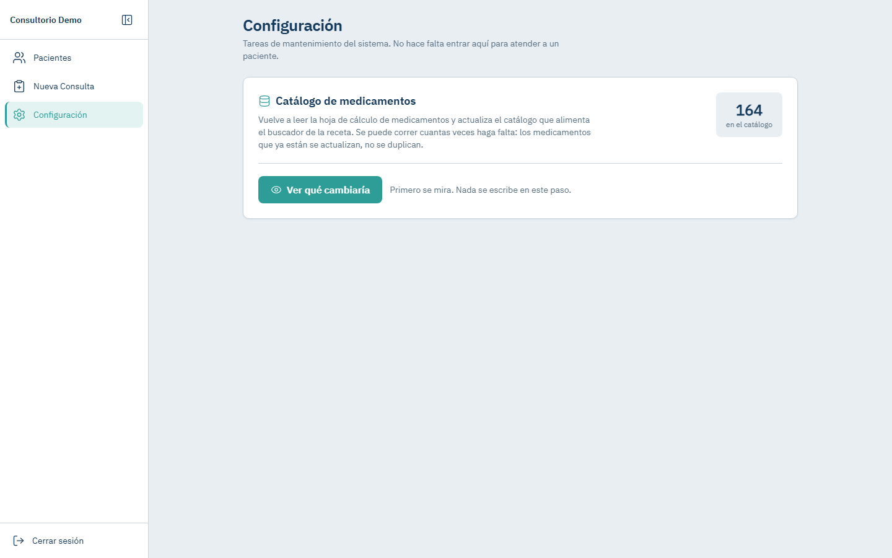
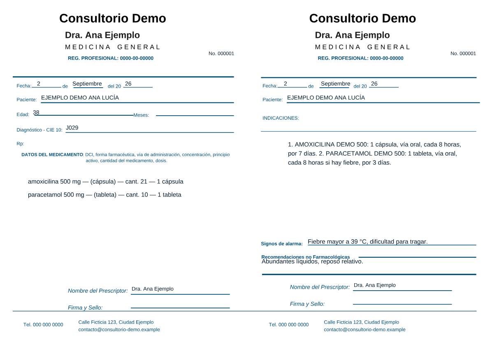
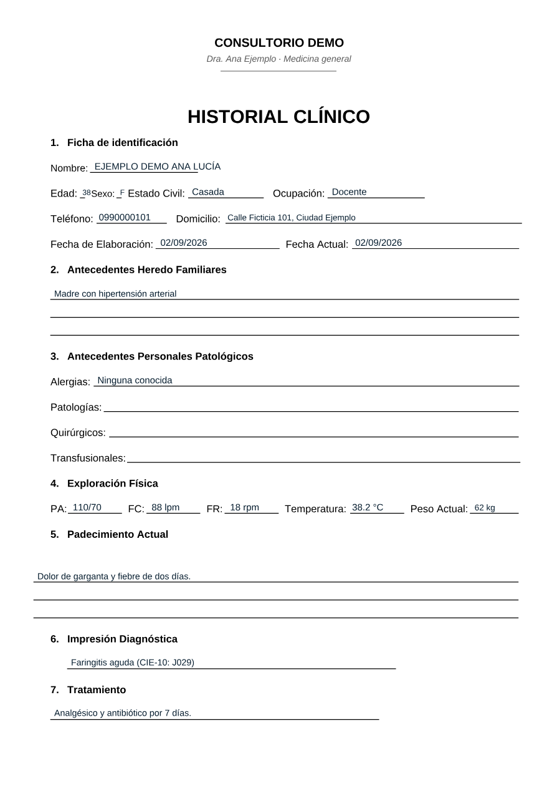
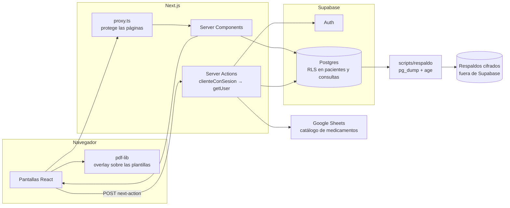

# Consultorio Demo — historia clínica y recetas

> **English summary.** A web app that replaces the paper clinical record and prescription pad of a single-doctor medical practice in Ecuador. Built with Next.js 16 (App Router, Server Actions), TypeScript, Tailwind CSS and Supabase (Postgres with Row Level Security). It manages patients, consultations with ICD-10 diagnoses and prescriptions, and prints both documents by overlaying the data on the practice's pre-printed templates with pdf-lib. Security is layered (route proxy, a session check inside every Server Action, RLS), environment guards fail closed so tests and scripts can never touch production, and the database is backed up daily with age encryption and a tested restore. Around 780 automated tests run in CI with no secrets. **This is an anonymized version of a system in real use**: every name, document number and contact detail here is fictitious.

Sistema web que reemplaza el historial clínico y la receta en papel de un consultorio médico con una sola usuaria, la doctora. **Es la versión anonimizada de un sistema en uso real**: el nombre del consultorio, la doctora y todos los pacientes de este repositorio son ficticios.

## El problema

La doctora llevaba la historia clínica y las recetas en papel, sobre sus formularios impresos, y la lista de pacientes y de medicamentos en hojas de cálculo. No había un historial consultable por paciente ni un número de receta controlado por el sistema. Las plantillas impresas funcionaban y no se querían rediseñar.

## La solución

Una aplicación web en la que la doctora busca al paciente, registra la consulta con su diagnóstico CIE-10 y su receta, y **imprime los mismos formularios de siempre**: el sistema escribe los datos encima de las plantillas originales (overlay con pdf-lib), midiendo que cada campo quepa en su espacio antes de generar el PDF.

## Funcionalidades

- **Pacientes:** búsqueda por nombre o documento con texto completo de Postgres (por prefijo, sin tildes), ficha con datos de contacto, antecedentes y acompañante, y validación de la cédula ecuatoriana por su dígito verificador ([ADR-008](docs/adr/ADR-008-validacion-cedula.md)). Pasaporte y otros documentos para extranjeros.
- **Menores de edad:** acompañante obligatorio, con la edad calculada en la hora de Ecuador también en la restricción de la base ([ADR-003](docs/adr/ADR-003-menor-edad-18-anos.md)).
- **Consulta:** antecedentes, signos vitales, diagnóstico con buscador CIE-10 (12 800+ códigos), tratamiento y receta con buscador del catálogo de medicamentos.
- **Receta** con número correlativo global y sin huecos: una consulta sin medicamentos no gasta número ([ADR-002](docs/adr/ADR-002-numero-receta-global.md)).
- **PDF de la historia clínica y de la receta** sobre las plantillas impresas, con límites de contenido medidos en la hoja real: si algo no cabe, se avisa antes de imprimir; nunca se trunca en silencio ([ADR-005](docs/adr/ADR-005-limites-contenido-receta.md), [ADR-007](docs/adr/ADR-007-espacio-historial.md)).
- **Línea de tiempo** de las consultas de cada paciente.
- **Configuración:** importación del catálogo de medicamentos desde Google Sheets, con vista previa de lo que cambiaría antes de escribir.

| | |
|---|---|
|  |  |
|  |  |
|  |  |
|  |  |

## Stack

- **Next.js 16** (App Router, Server Components, Server Actions, `proxy.ts`) y **TypeScript** estricto.
- **Tailwind CSS 4** con un sistema de diseño propio ([Sistema-de-Diseno](docs/diseno/Sistema-de-Diseno.md)) e IBM Plex servida localmente.
- **Supabase:** Postgres con Row Level Security, Auth y `@supabase/ssr`.
- **pdf-lib** para el overlay sobre las plantillas PDF.
- **Vitest** (con PGlite para probar restricciones de Postgres sin servidor) y **Playwright** para el E2E.
- **GitHub Actions** y Dependabot. Despliegue: en evaluación.

## Arquitectura

El navegador nunca habla con Supabase ni con Google: todo pasa por Server Components y Server Actions (`connect-src 'self'` en la CSP). Las decisiones de arquitectura están en [`docs/`](docs/README.md).

## Seguridad

- **Tres capas de control de acceso** ([Seguridad-OWASP](docs/arquitectura/Seguridad-OWASP.md)):
  - `proxy.ts` protege las páginas;
  - cada Server Action verifica la sesión dentro de sí misma con `clienteConSesion()`, que usa `getUser()` y nunca `getSession()`, porque esta lee la cookie sin validarla;
  - RLS en Postgres es la última red.
- **La regla se prueba sola:** `tests/sesion-acciones.test.ts` descubre todas las Server Actions del proyecto y falla si alguna hace algo antes de verificar la sesión.
- **Sesión revocada a mitad de una consulta:** antes terminaba en un 404 que perdía lo escrito. Ahora la acción responde «sesión caducada», el formulario conserva el texto y la respuesta no lleva el borrado de las cookies. Lo comprueba un script contra el navegador real (`npm run verificar:sesion-revocada`).
- **Cabeceras** (`next.config.ts`): `X-Frame-Options: DENY`, `nosniff`, `Referrer-Policy: same-origin` (las URLs llevan el id del paciente), `Permissions-Policy` restrictiva, COOP y HSTS en producción. La **CSP** corre en Report-Only, con lo observado documentado y el paso a una CSP aplicada con nonce planteado.
- **Guardas de entorno que fallan cerradas** (`lib/entorno.ts`, [Entornos](docs/arquitectura/Entornos.md)). Las pruebas y la siembra solo corren contra dev, y los importadores exigen `--produccion` escrito a mano. Un proyecto desconocido se trata como producción. Los scripts solo obtienen un cliente de Supabase a través de la guarda, y una prueba lo verifica.
- **Ningún secreto llega al navegador:** `npm run verificar:bundle` busca los valores de los secretos en lo que se envía al cliente. En el CI busca centinelas falsos, para que «no encontré nada» no sea un falso verde.
- **Hook para agentes de IA:** `.claude/hooks/bloquear-busqueda-recursiva.mjs` impide que un agente de código lea `.env` con búsquedas recursivas por la terminal. Nació de un incidente real: un `grep -r` de un subagente mostró la contraseña de la base de desarrollo, que se rotó de inmediato. Tiene su propia suite de pruebas.

## Decisiones (ADR)

| ADR | Decisión |
|---|---|
| [ADR-001](docs/adr/ADR-001-sin-control-inventario.md) | Sin control de inventario de medicamentos |
| [ADR-002](docs/adr/ADR-002-numero-receta-global.md) | Número de receta correlativo y global, sin huecos |
| [ADR-003](docs/adr/ADR-003-menor-edad-18-anos.md) | Acompañante obligatorio para menores de 18 años |
| [ADR-004](docs/adr/ADR-004-plan-supabase-pro.md) | Plan de Supabase y respaldo local obligatorio en cualquier plan |
| [ADR-005](docs/adr/ADR-005-limites-contenido-receta.md) | Límites de contenido en la receta: tamaño mínimo legible y caracteres máximos |
| [ADR-006](docs/adr/ADR-006-campos-opcionales-migracion.md) | Campos opcionales por la migración histórica |
| [ADR-007](docs/adr/ADR-007-espacio-historial.md) | Espacio de los campos en la historia clínica |
| [ADR-008](docs/adr/ADR-008-validacion-cedula.md) | Validación del documento de identidad |

## Pruebas y CI

- **Unas 780 pruebas con Vitest:** validación de formularios con `FormData` real, cálculo de edades en la zona horaria de Ecuador, generación de PDF con el texto extraído y comparado, límites de espacio, la regla de sesión en todas las acciones, el proxy, la guarda de entorno y el hook. Las restricciones de Postgres se prueban en **PGlite**, un Postgres en WebAssembly, sin servidor. Las pocas que necesitan un proyecto de Supabase se saltan solas sin `.env`.
- **E2E con Playwright** (opcional, en local contra un proyecto de dev): registra un paciente ficticio, guarda una consulta y lee el texto del PDF de la receta. Limpia lo que creó aunque falle.
- **CI** (`.github/workflows/ci.yml`), **sin ningún secreto**: `npm audit` de producción, lint, `tsc`, Vitest, build, una verificación de qué rutas pueden ser estáticas, `verificar:bundle` y enlaces de la documentación. Las actions están fijadas por SHA y Dependabot agrupa y retrasa las actualizaciones ([Verificacion-y-CI](docs/arquitectura/Verificacion-y-CI.md)).

## Respaldos cifrados

`scripts/respaldo/` ([README](scripts/respaldo/README.md)) hace un respaldo diario de la base:
- `pg_dump` de `public` y de `auth`, sin las tablas de sesiones;
- cifrado con **age**;
- retención de 14 diarios y 8 semanales;
- un log sin secretos;
- una tarea programada de Windows.

`restaurar-prueba.ps1` descifra un respaldo, lo restaura en una base aparte y compara conteos, el valor de la secuencia de recetas, las políticas RLS y una huella de los GRANTs. Solo acepta una lista exacta de errores esperados de `pg_restore`, de modo que un respaldo cortado o corrupto hace fallar la prueba.

## Problemas resueltos y lecciones

- **La víspera de cumplir 18, la base dejaba entrar a un menor sin acompañante.** El `CHECK` tenía dos errores: `age() >= '18 years'` compara intervalos con meses de 30 días, y su «hoy» era el de UTC, así que entre las 19:00 y la medianoche de Ecuador ya era el día siguiente. La migración que lo corrige usa la hora de Ecuador, y una prueba compara la regla de la app y la de la base en 1 098 casos de borde con dos relojes ([ADR-003](docs/adr/ADR-003-menor-edad-18-anos.md)). En la app, la trampa equivalente es que una fecha `YYYY-MM-DD` pasada por `new Date()` es medianoche UTC y en Ecuador resta un día. Hoy toda fecha pasa por funciones propias.
- **Una cédula mal tecleada es un duplicado futuro.** La próxima vez se busca la cédula correcta, no se encuentra a nadie y se registra al paciente otra vez, y el `UNIQUE` no lo evita porque dos cédulas distintas no chocan. Pasó en la migración inicial de datos. Llevó a validar el dígito verificador, que detecta cualquier error de un solo dígito, y a separar el tipo de documento para los extranjeros ([ADR-008](docs/adr/ADR-008-validacion-cedula.md)).
- **Las consultas sin receta dejaban huecos en el correlativo**, porque el número se asignaba al insertar la consulta. Pasó a asignarse solo cuando hay medicamentos ([ADR-002](docs/adr/ADR-002-numero-receta-global.md)).
- **El texto que no cabía en la hoja se perdía al imprimir.** Ahora cada campo se mide contra las líneas reales de la plantilla, medidas en la imagen, y se bloquea antes de generar el PDF ([ADR-005](docs/adr/ADR-005-limites-contenido-receta.md), [ADR-007](docs/adr/ADR-007-espacio-historial.md)).
- **«Verificar es ejecutar».** `tsc`, `eslint` y el build pasaban con un proxy que dejaba rutas abiertas y con un doble scroll. Desde entonces cada cambio se comprueba con el servidor levantado, una sesión real y el texto del PDF extraído ([Trampas-Recurrentes](docs/arquitectura/Trampas-Recurrentes.md)).
- **Los metadatos de los archivos también publican.** Al anonimizar este repositorio, las plantillas PDF exportadas traían autor y título originales en sus metadatos. Las de aquí se generan desde cero (`scripts/generar-plantillas.mjs`) con la misma geometría.

## Cómo se construyó

Se desarrolló con Claude Code como agente de programación, bajo revisión humana. Cada cambio entra por rama y PR, con el CI en verde y revisión antes de fusionarse. Las reglas para el agente están en [`CLAUDE.md`](CLAUDE.md): plan antes del código en los cambios grandes, confirmación explícita antes de cualquier escritura en producción, y «verificar es ejecutar». El hook `.claude/hooks/bloquear-busqueda-recursiva.mjs` hace cumplir la regla de no leer `.env` desde la terminal.

## Cómo correrlo en local

Requisitos: Node 24 y un proyecto propio de Supabase (el plan gratis alcanza).

1. **Dependencias:** `npm ci`.
2. **Esquema:** aplica las migraciones de `supabase/migrations/` en orden, con el SQL Editor de tu proyecto o con la CLI (`npx supabase link --project-ref <ref>` y `npx supabase db push`).
3. **Datos de ejemplo:** ejecuta `supabase/seed.sql`: 20 pacientes, consultas y recetas ficticias, más un mínimo de CIE-10 y de medicamentos. Para el catálogo CIE-10 completo, corre `node --env-file=.env scripts/import-cie10.mjs` después de crear el `.env` del paso 5.
4. **Usuario:** en *Authentication → Users* crea un usuario con correo y contraseña. Es la «doctora» de la demo.
5. **Entorno:** copia `.env.example` a `.env` y completa la URL, las claves y `SUPABASE_REF_DEV`, que es el subdominio de tu URL.
6. **App:** `npm run dev` y entra en `http://localhost:3000`.
7. **Pruebas:** `npm test`, y opcionalmente `npm run test:e2e` con `USUARIO_PRUEBA_CORREO` y `USUARIO_PRUEBA_CLAVE` en el `.env`.

## Sobre los datos

Todos los nombres de este repositorio son ficticios y evidentes («EJEMPLO DEMO…», «FICTICIO…», «PRUEBA…»), igual que los teléfonos, correos (`example.com`) y direcciones. **Los documentos de identidad se generaron con el algoritmo de la cédula ecuatoriana**, con patrones evidentes, y no corresponden a registros reales. Las capturas se tomaron contra un proyecto de desarrollo que solo tiene datos sintéticos. Ningún dato de pacientes reales salió del sistema en uso.

## Autor

Erick Villavicencio — Ingeniería de Software, Universidad Estatal de Milagro (Ecuador) — LinkedIn: https://www.linkedin.com/in/erick-villavicencio

## Licencia

**Código visible, todos los derechos reservados.** Este repositorio no incluye una licencia de código abierto: puedes leerlo, pero no se concede permiso para usarlo, copiarlo, modificarlo ni distribuirlo sin autorización del autor.
